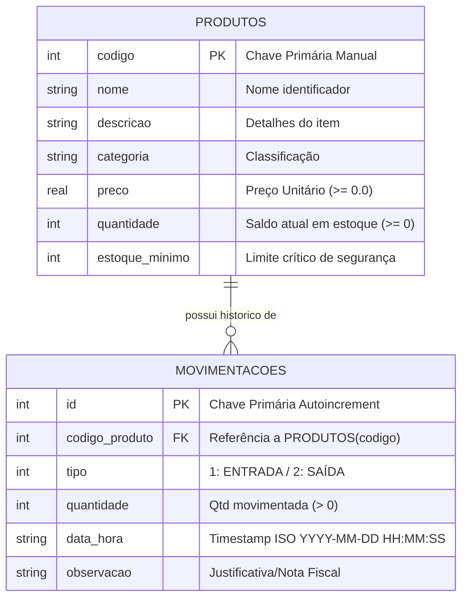
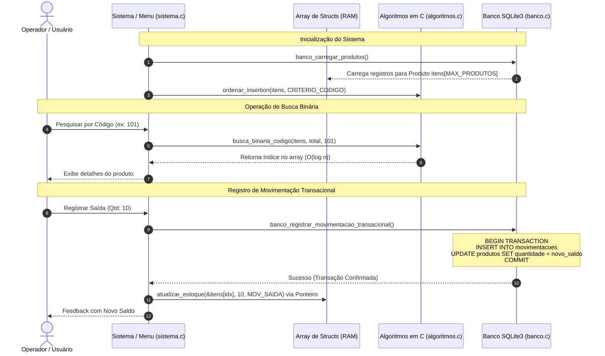

# Documento de Arquitetura e Engenharia de Software

**Projeto:** Sistema de Controle de Estoque  
**Disciplina:** Algoritmos e Programação II — Engenharia da Computação (2026)  
**Padrão:** C11 Modular com Persistência Relacional SQLite3  

---

## 1. Visão Geral da Arquitetura

O sistema adota uma arquitetura em camadas desacoplada e modular, garantindo separação clara de responsabilidades:

1. **Camada de Apresentação e Interação (`main.c` / `src/sistema.c`):**
   - Controle do fluxo de menus, renderização de tabelas e sanitização de dados da interface console.
2. **Camada de Lógica de Negócio e Algoritmos (`src/algoritmos.c` / `src/util.c`):**
   - Execução das operações de busca linear, busca binária manual e ordenação manual diretamente na memória RAM, sem delegar computação ao motor SQL.
3. **Camada de Persistência e Acesso a Dados (`src/banco.c`):**
   - Encapsulamento completo da API C do SQLite3, consultas estritamente parametrizadas e controle transacional ACID.
4. **Camada de Modelos de Dados (`include/modelos.h`):**
   - Definição canônica das estruturas de dados (`struct Produto`, `struct Movimentacao`, enumerações e catálogo).

---

## 2. Diagrama Entidade-Relacionamento (ER)

A persistência adota modelagem relacional de 3ª Forma Normal (3NF) com integridade referencial habilitada via chave estrangeira em cascata:

---

## 3. Fluxo de Dados e Ciclo de Vida dos Dados (SQLite ↔ RAM)

O diagrama abaixo ilustra como a aplicação atende ao requisito fundamental: **o banco de dados é o repositório persistente, mas a busca e ordenação são processadas estritamente na memória RAM por algoritmos desenvolvidos pelo grupo**.

---

## 4. Garantia de Integridade Transacional (ACID)

Para evitar inconsistências (como gravar uma movimentação de estoque sem debitar o saldo do produto, ou vice-versa), toda movimentação opera sob controle atômico:

1. **Atomicidade:** `sqlite3_exec(db, "BEGIN TRANSACTION;", ...)` é emitido. Caso qualquer das instruções subsequentes falhe, um `ROLLBACK` é acionado imediatamente.
2. **Consistência:** As restrições `CHECK(quantidade >= 0)` e `FOREIGN KEY (codigo_produto) REFERENCES produtos(codigo) ON DELETE CASCADE` impedem saldos negativos e registros órfãos.
3. **Isolamento:** O SQLite garante isolamento de escrita via locks de banco em nível de arquivo.
4. **Durabilidade:** Ao executar `sqlite3_exec(db, "COMMIT;", ...)`, a alteração é escrita de forma síncrona no disco.

---

## 5. Consultas Estritamente Parametrizadas (Segurança)

Em conformidade rigorosa com as boas práticas de engenharia de software e segurança:
- **Nenhuma instrução SQL utiliza concatenação de strings** (`sprintf` ou `strcat`).
- Todas as operações utilizam a API preparada do SQLite:
  - `sqlite3_prepare_v2()`
  - `sqlite3_bind_int()`, `sqlite3_bind_text()`, `sqlite3_bind_double()`
  - `sqlite3_step()`
  - `sqlite3_finalize()`
Isso elimina qualquer risco de **SQL Injection** e garante tratamento correto de aspas e caracteres especiais.
